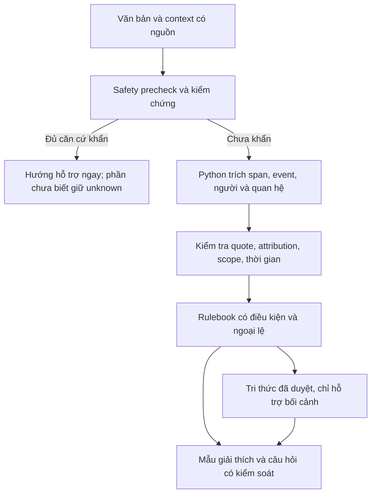

# Luồng cục bộ và dataset 2.0

Cập nhật tạm thời 12/11/2026: đã nối nhánh này vào website và extension chính qua
/api/analyze với mode=local_rules, có thể quay lại two_pass. Xem
[TEMP_LOCAL_MODE.md](TEMP_LOCAL_MODE.md). Những đoạn nói chưa nối client bên dưới
mô tả thời điểm bàn giao v2 trước khi bật công tắc thử này.

Hồ sơ đầy đủ tại [data/v2](../data/v2/README.md). Thêm bộ trích an toàn, schema gán
nhãn, rulebook, mẫu diễn đạt, validator, công cụ chia nhóm/export và bản pilot.
Không gọi hai lượt Gemini trong đường chạy mới. Cấu hình/provider cũ giữ nguyên.

**POST /api/analyze-local** nhận CaseInput (messages/context_facts/user_question),
chỉ input, không nhận metadata/annotations/expected. Trả LocalResult với
analysis_status, annotations.answers_18/events/relations/spans/participants,
assessment, knowledge_status, source_matches, support_contacts, versions và thời gian.
assessment có risk_status bốn mức, safety_urgency riêng, evidence_refs,
urgency_evidence_refs, applicable_rule_ids, prohibited_conclusions và text có kiểm soát.

Nếu lỗi, HTTP 503 có thể vẫn giữ thông tin urgent đã có căn cứ; risk_status=null
khi chưa kiểm tra được, không tự clear. /local là giao diện thử riêng, giữ thông
tin khẩn ở đầu, câu hỏi tùy chọn, quote textContent, chống phản hồi cũ, không hiện
answers/source matches/raw nội bộ. Source OCR là văn bản được cung cấp, không xác
minh OCR đọc đúng ảnh. Parent cảnh báo áp cho OCR minh họa, không miễn bình luận độc lập.

/api/observe vẫn dùng bộ trích 18 trường trước. /api/analyze và extension vẫn dùng
luồng cấu hình cũ; không thay client cũ sang dữ liệu v2 một cách ngầm định. Chưa có
mô hình tự huấn luyện, nguồn RAG thật đã duyệt hoặc danh bạ hỗ trợ vùng đã xác minh.

[Báo cáo kiểm thử, số liệu và giới hạn](reports/local_v2_20261112/README.md).
